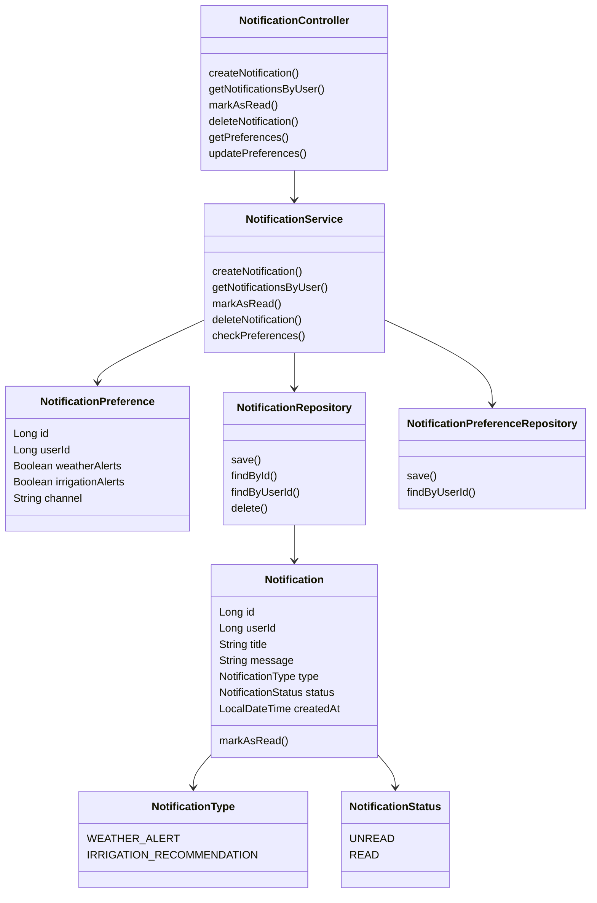

# Notification Service - Class Diagram

## Description

The Notification Service manages weather alerts and irrigation recommendations sent to farmers.

## Class Diagram

## Explanation

- **Notification:** Represents an alert or recommendation sent to a farmer.
- **NotificationPreference:** Stores the farmer's notification preferences.
- **NotificationController:** Exposes REST API endpoints.
- **NotificationService:** Contains the business logic.
- **NotificationRepository:** Handles database operations using Spring Data JPA.

## Technologies

- Java
- Spring Boot
- Spring Data JPA
- PostgreSQL
