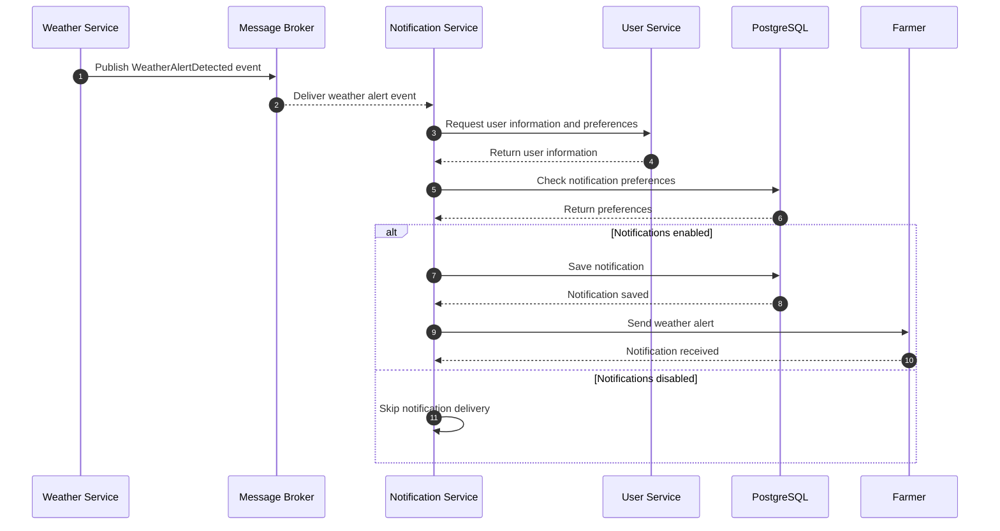

# Notification Service - Sequence Diagram

## Scenario: Weather Alert Notification

### Description
When the Weather Service detects extreme weather conditions, it publishes an event. The Notification Service receives this event, checks the user's preferences, saves the notification and sends it to the farmer.

## Communication Types

### Asynchronous Communication
Weather Service publishes the WeatherAlertDetected event through a message broker. Notification Service consumes this event without requiring the Weather Service to wait for processing.

### Synchronous Communication
Notification Service can communicate with User Service using REST API to retrieve user information when necessary.

### Database Communication
Notification Service uses Spring Data JPA to save and retrieve notifications from PostgreSQL.

## Expected Result
The farmer receives a notification about important weather conditions and can consult it through the application.
